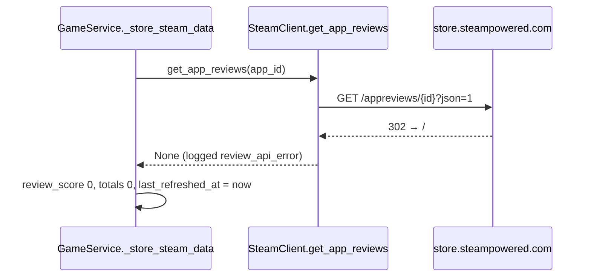

# Fix Steam review scores: move to IUserReviewsService/GetAppReviews

The functional spec is what is approved; the technical spec serves it. If they conflict, the functional spec wins.

- **Task:** I've add my phpssid token in order to get a fresh load of giveaway, but I can't seem to load the review score from steam, so everygame is at score 0. let's first fix the review score from steam, so I can properly test the auto-join update locally first. The auto-join, will be done on top of the steam review fix
- **Addendum (2026-11-04):** We are currently fixing the steam review score, the current API we use has been deprecated — [Steamworks announcement](https://steamcommunity.com/groups/steamworks/announcements/detail/676258795703241581), [IUserReviewsService#GetAppReviews](https://partner.steamgames.com/doc/webapi/IUserReviewsService#GetAppReviews), [migration notes](https://partner.steamgames.com/doc/webapi/IUserReviewsService#migrating).
- **Date:** 2026-11-04
- **Tier:** Tier T2 · backend · ~10 agents · opus×8 sonnet×2 · pace auto · build → challenge×1 → review(correctness, security, stack) → verify → tests → docs → qa — raised from T1 by the risky path `backend/src/utils/`
- **Pace:** auto
- **Branch:** dev/steam-reviews (from origin/master at 1ab359a; dev/autojoin-engine is rebased on it afterwards)
- **Status:** ready

## Functional spec

### Why

Every game fetched since Steam's change stores `review_score 0, total_reviews 0`. Valve has deprecated `GET store.steampowered.com/appreviews/{id}?json=1`; it now answers `302` to the store home for every app, from the container and from a plain `curl`. The client treats a non-200 as "no reviews", so the game service writes zeros (and overwrites the scores of games it already knew). With scores at 0 the `score_below_min` and `reviews_below_min` filters skip everything, which makes the auto-join redesign untestable locally. The genres, release date and type still arrive through `appdetails`, which is unchanged.

The replacement Valve names, `GET api.steampowered.com/IUserReviewsService/GetAppReviews/v1/`, needs no key and returns the same `query_summary` block (`review_score`, `review_score_desc`, `total_positive`, `total_negative`, `total_reviews`) the old endpoint did, so the stored columns and the score scale do not change. Verified live on 2026-11-04 for apps 440 and 2525380.

### Goals

- Review counts and the 0–9 score come back for every game with reviews, from the endpoint Valve recommends (`IUserReviewsService/GetAppReviews`).
- The score stays on Steam's own summary bucket (9 = Overwhelmingly Positive … 0 = fewer than ten reviews), computed by Steam over the API's default population (English reviews by Steam purchasers, D2), so `autojoin_min_score` keeps its scale. The counts are smaller than the store page's, and rows fetched before the outage were computed over a wider population; they converge as rows are refreshed.
- A reviews request that fails is treated as a failure, not as "no reviews": an existing row keeps its cached scores, and a new row is not stamped refreshed, so it is retried by the bounded stale-refresh instead of waiting seven days.
- A Steam 429 on the reviews call trips the shared cool-down like any other Steam 429.

### Non-goals

- No change to how or when games are fetched (read-through on sync, bounded `refresh_stale_games`, 7-day staleness, 180 s cool-down).
- No Steam Web API key: the anonymous rate limit is enough for ten games per cycle; `SteamClient.api_key` stays optional and is not sent.
- No use of the review texts, pagination or the new filters; only `query_summary` is read.
- No automatic repair of the rows written during the outage (see Migration for the one-off).
- No frontend change; `review_score` and the three counts keep their type and scale.

### Acceptance

- [ ] `SteamClient.get_app_reviews(440)` makes exactly one request, `GET https://api.steampowered.com/IUserReviewsService/GetAppReviews/v1/` with the single query parameter `input_json` = `{"appid": 440, "num_per_page": 1}`, through the existing `_request` helper (shared rate limiter, pooled client, its User-Agent); no `key`, `languages` or `purchase_type` parameter (the API defaults, D2); `/appreviews/` is no longer requested anywhere.
- [ ] A `200` body `{"response": {"query_summary": {"review_score": 8, "total_positive": 900, "total_negative": 100, "total_reviews": 1000, …}}}` returns `{"review_score": 8, "total_positive": 900, "total_negative": 100, "total_reviews": 1000}` as ints; a summary field that is missing counts as 0.
- [ ] A `200` body whose `response` has no `query_summary` (unknown app, or `{"response": {}}`), or a body that is not an object, returns `None` ("no reviews"), logged at warning (`review_api_no_data`), never an exception.
- [ ] `302`, `403` and a `500` that outlives the retries raise `SteamAPIError`; `404` raises `SteamAPINotFoundError` (a `SteamAPIError`); invalid JSON raises `SteamAPIError`; `429` raises `SteamAPIRateLimitError`. No broad `except` swallows them into `None`.
- [ ] Game service, existing row with cached reviews (`total_reviews > 0`), reviews raise `SteamAPIError`: the row keeps its cached `review_score`, `total_positive`, `total_negative`, `total_reviews`; `last_refreshed_at` is bumped (as today for a failed fetch).
- [ ] Game service, existing row without cached reviews (`total_reviews == 0`), reviews raise `SteamAPIError`: zeros kept, `last_refreshed_at` set to `now − 7 d + REVIEW_RETRY_DELAY` (6 h) so the row is due again after 6 h behind the rows already stale; `_store_steam_data` returns `FetchStatus.FAILED`, `refresh_game` reports it and `refresh_stale_games` does not count it (accepted deviation, see Log).
- [ ] Game service, new row, reviews raise `SteamAPIError`: the row is created with zeros and `last_refreshed_at` `NULL`, so `needs_refresh` is true and `refresh_stale_games` picks it up; a `429` still trips `steam_cooldown` and leaves `last_refreshed_at` alone on an existing row (unchanged).
- [ ] Game service, reviews return `None` (genuinely no reviews): zeros are stored and the row is stamped refreshed (as today).
- [ ] No reviews request is made for bundles or DLC (unchanged).
- [ ] `ruff check .` and `pytest -q` pass; changed-line coverage ≥ 95 %; `docs/BACKEND_ARCHITECTURE.md` and `docs/API.md` name `GetAppReviews` where they named `appreviews`.

### Decisions

- **D1. Where do review counts come from now that `/appreviews` is deprecated?**
  - `GET api.steampowered.com/IUserReviewsService/GetAppReviews/v1/` (recommended): the replacement Valve names in the deprecation notice; public, no key, answers 200 today; returns the same `query_summary` fields the old endpoint did, so no derivation and no scale change. Consequence: anonymous calls share a lower rate limit and answer 429 when exceeded (the existing cool-down handles that); responses may be cached by Steam for up to 10 minutes.
  - `GET store.steampowered.com/appreviewhistogram/{id}` (the earlier plan): undocumented store endpoint that answers 200 today; gives monthly up/down rollups, so the score has to be emulated from a bucket table and the totals differ from the store page (1.37 M summed vs 1.26 M reported). Consequence: more code, a scale the reviewers have to check, and the next endpoint Valve may retire.
  - `appdetails.recommendations.total`: already fetched, but one number (no positive/negative split, no score), and for Team Fortress 2 it reports 48 214 where the store page says 1.26 M.
  - Chosen: `IUserReviewsService/GetAppReviews`, the replacement Valve names; same fields, no key, least code.

- **D2. Which reviews are counted?**
  - `languages: ["all"]`, `purchase_type: All` (recommended): the population behind the store page's summary. Live for app 440: score 8 "Very Positive", 1 144 171 / 112 454, total 1 256 625. Consequence: `review_score` keeps the meaning the store page and the stored rows have.
  - The API defaults (English reviews by Steam purchasers only): fewer parameters, but app 440 becomes score 6 "Mostly Positive" with 27 691 reviews; `autojoin_min_score` and the rows fetched before the outage silently change meaning.
  - Chosen: the API defaults (English reviews by Steam purchasers only), the user's choice: fewer parameters; app 440 reads 6 / 27 691 where the store page shows 8 / 1.26 M, and `autojoin_min_score` is compared against that bucket from now on.

- **D3. What is a non-200 reviews answer: "no reviews" or a failure?**
  - A failure (recommended): let `_request` raise `SteamAPIError` (`SteamAPIRateLimitError` on 429) so `_store_steam_data` takes its existing `review_fetch_failed` path: cached scores kept, cool-down tripped on 429. Consequence: an outage like this one can no longer overwrite good rows with zeros; "no reviews" is only a 200 without a `query_summary`.
  - Keep returning `None` (today): simpler, but during the outage it wrote zeros over every known game's score, which is the second half of this bug.
  - Chosen: a failure (raise), so an outage can no longer overwrite cached scores with zeros.

- **D4. Is a new row whose reviews failed "refreshed"?**
  - Not refreshed (recommended): create it with zeros and `last_refreshed_at NULL`, the same treatment a throttled fetch already gets on an existing row; `needs_refresh` is true, so the bounded `refresh_stale_games` (10 per cycle) retries it. Consequence: during an outage the read-through path (`is_stale_by_age` is true for a NULL) re-fetches the game once per sync until it succeeds; `appdetails` is cached by Steam and the 429 cool-down bounds the cost.
  - Stamp it refreshed (today): zeros for seven days; this is what left the 113 rows at 0.
  - Chosen: not refreshed (`last_refreshed_at NULL`), so the bounded stale-refresh retries the row.

## Technical spec

### Current state

`SteamClient.get_app_reviews` ([steam_client.py:399-462](../../backend/src/utils/steam_client.py#L399-L462)) opens its own short-lived `httpx.AsyncClient` with browser headers (bypassing `_request`, the rate limiter and the pooled client), requests `/appreviews/{app_id}?json=1`, returns `None` on any non-200 (logged `review_api_error`) and otherwise reads `query_summary.{review_score,total_positive,total_negative,total_reviews}`; any exception is logged and also returns `None`. `GameService._store_steam_data` ([game_service.py:375-466](../../backend/src/services/game_service.py#L375-L466)) calls it for type `game` only; a dict fills the four fields, `None` leaves them at 0, and only an exception sets `review_fetch_failed` (cached values kept) or `review_rate_limited` (cool-down tripped, `last_refreshed_at` untouched). Since Steam's change the call answers 302, so every game is saved with zeros and stamped refreshed. The mocked-transport test `TestAppReviews` ([test_steam_client_http.py:97-131](../../backend/tests/integration_mocked/test_steam_client_http.py#L97-L131)) asserts the old URL and the `None` on 403.



Today's flow: the redirect is read as "no reviews" and the zeros are stamped as fresh data.

### Proposed model

`get_app_reviews` calls `self._request(f"{self.STEAM_API_BASE}/IUserReviewsService/GetAppReviews/v1/", {"input_json": json.dumps({...})})` with `appid` and `num_per_page: 1` only (the summary is only on the first page; one review keeps the payload small; `languages` and `purchase_type` are left at the API defaults per D2). `_request` already maps 404 → `SteamAPINotFoundError`, 429 → `SteamAPIRateLimitError`, 5xx → retry then `SteamAPIError`, other non-200 → `SteamAPIError`, and applies the shared rate limiter and the pooled client with its User-Agent; a `ValueError` from `response.json()` is wrapped into `SteamAPIError` by `get_app_reviews`. The 200 body is read as `body["response"]["query_summary"]`; when the body is not a dict or the summary is absent, `None` is returned with a `review_api_no_data` warning; otherwise the four ints are returned exactly as today. The bespoke `httpx.AsyncClient` and the `except Exception → None` go away. In `_store_steam_data`, D4: when `review_fetch_failed` is true and the row is new, `last_refreshed_at` is left `None`. For an existing row (accepted deviation, see Log): with cached reviews the row is stamped now; without them it gets the back-dated `_review_retry_at()` stamp (`now − STALE_AFTER_DAYS + REVIEW_RETRY_DELAY`) and the status `FetchStatus.FAILED`, so placeholder zeros are never fresh and failing rows rotate through the stale queue.

```mermaid
sequenceDiagram
    participant GS as GameService._store_steam_data
    participant SC as SteamClient.get_app_reviews
    participant RQ as SteamClient._request
    participant Steam as api.steampowered.com
    GS->>SC: get_app_reviews(app_id)
    SC->>RQ: GET /IUserReviewsService/GetAppReviews/v1/ input_json {appid, num_per_page 1}
    RQ->>Steam: (rate limiter, pooled client)
    alt 200 with response.query_summary
        Steam-->>SC: {review_score, total_positive, total_negative, total_reviews}
        SC-->>GS: the four ints
    else 200 without query_summary
        SC-->>GS: None (no reviews)
    else 429
        RQ-->>GS: raise SteamAPIRateLimitError (cool-down trips)
    else other non-200 / bad JSON
        RQ-->>GS: raise SteamAPIError (cached scores kept; new row not stamped)
    end
```

Proposed flow: the same four fields, read through the shared request path; a failure is a failure.

### Alternatives

See D1 (data source) and D2 (review population). Keeping a separate browser-headed client as today was considered and dropped: `api.steampowered.com` answers the pooled client's User-Agent, and `_request` gives the rate limiter, the 5xx retry and the exception mapping for free.

### Migration

No schema change. Rows written during the outage (`type = 'game'`, `review_score = 0`, `total_reviews = 0`, `last_refreshed_at` set) are refreshed by the 7-day staleness or by `POST /api/v1/games/refresh-stale`. For the local `config-dev` database the lead runs, after the user's go, `UPDATE games SET last_refreshed_at = NULL WHERE type = 'game' AND total_reviews = 0;` so the bounded stale-refresh backfills them 10 per cycle. Production rows fetched before Steam's change keep their scores.

### Risks and assumptions

- The anonymous rate limit of `GetAppReviews` is not published. `refresh_stale_games` sends at most 10 reviews calls per cycle and the read-through path one per unknown game per sync; a 429 trips the 180 s cool-down. The security reviewer should confirm no request is sent during the cool-down and that the `_request` 5xx retry (1 + 2 + 4 s) stays bounded.
- Steam may cache anonymous answers for up to 10 minutes; irrelevant at a 7-day refresh cadence.
- `query_summary` is documented as present only on the first page with `review_type All`; the call never pages and never sets `review_type`, so the summary is always requested. An unknown app answers 200 with `{"response": {}}` (verified), which is the "no reviews" case.
- Raising instead of returning `None` changes `get_app_reviews`'s contract; its only caller is `_store_steam_data`, which already handles exceptions. The unit tests in `test_services_game_service.py` mock it with `AsyncMock` and keep working.
- `_request` now serialises reviews calls behind the same `RateLimiter` (100 per 60 s) as `appdetails`; at 2 calls per game and 10 games per cycle this never waits.
- D4 makes a new row retryable through the read-through path during an outage; the 429 cool-down and `appdetails` being cached by Steam bound the extra requests.

### Briefs

Edit these before the build stage to steer: the devs build from exactly what is written here. Every brief traces to a goal or an acceptance criterion above.

#### backend

- Goal: `get_app_reviews` returns the same four fields from `IUserReviewsService/GetAppReviews` through `_request`, and a failed reviews request is a failure the game service keeps cached data through (D1–D4).
- Files: `backend/src/utils/steam_client.py` (`get_app_reviews` only); `backend/src/services/game_service.py` (`_store_steam_data`, new-row `last_refreshed_at`; the comments and docstrings that say `appreviews`); `backend/tests/integration_mocked/test_steam_client_http.py` (`TestAppReviews`); `backend/tests/unit/test_services_game_service.py` (failure paths; docstrings that say `appreviews`); `backend/src/workers/automation.py` line 32 comment; `docs/BACKEND_ARCHITECTURE.md` lines 190–198 and `docs/API.md` lines 390–394 (rename `appreviews` → `GetAppReviews`, state the failure semantics).
- Steps:
  1. Rewrite `get_app_reviews`: build `input_json = json.dumps({"appid": app_id, "num_per_page": 1})` and call `await self._request(f"{self.STEAM_API_BASE}/IUserReviewsService/GetAppReviews/v1/", {"input_json": input_json})`; wrap a `ValueError` from the JSON parse into `SteamAPIError("Steam reviews: invalid JSON")`. Read `summary = body.get("response", {}).get("query_summary")` defensively (body or `response` not a dict → treat as missing). Missing → `logger.warning("review_api_no_data", app_id=app_id)` and `return None`. Otherwise return the four keys as `int(summary.get(key, 0))`. No `key`, `languages` or `purchase_type` parameter, no cookies, no referer. Remove the bespoke `httpx.AsyncClient` and the `except Exception → None`; keep the docstring accurate (Raises: `SteamAPIError`, `SteamAPIRateLimitError`; no `>>>` claims that no longer hold). Add `import json` with the stdlib imports.
  2. In `_store_steam_data`, pass `last_refreshed_at=None if review_fetch_failed else utcnow()` on the create path. Existing row (as built, after the review): throttled → `last_refreshed_at` unchanged, RATE_LIMITED; answered or failed with cached reviews → stamped now, REFRESHED; failed without cached reviews → `_review_retry_at()` and FAILED. `_store_steam_data` returns `(Game, FetchStatus)`; `refresh_game` passes the status through and `refresh_stale_games` skips a FAILED row without counting it. `STALE_AFTER_DAYS = 7` is shared from `repositories/game.py`.
  3. Grep the repository for `appreviews` and `appreviewhistogram`; nothing outside this plan document may still reference them (comments and docstrings included).
- Tests to write:
  - `test_steam_client_http.py::TestAppReviews`, against `RoutedTransport` with path `/IUserReviewsService/GetAppReviews/v1/`: success returns the four ints and asserts host `api.steampowered.com`, exactly one request, `json.loads(request.url.params["input_json"]) == {"appid": 2525380, "num_per_page": 1}` and no `key` param; summary missing a field → 0; `{"response": {}}` → `None`; body `[]` → `None`; 302 → `SteamAPIError`; 403 → `SteamAPIError`; 429 → `SteamAPIRateLimitError`; 200 with invalid JSON → `SteamAPIError`; exactly one request in each case (the `no_sleep` fixture covers the 5xx path if tested).
  - `test_services_game_service.py`: new row + `SteamAPIError` is created with zeros and `last_refreshed_at None` (`needs_refresh` true, cool-down not active); new row + `SteamAPIRateLimitError` trips the cool-down and leaves `last_refreshed_at None`; `None` (no reviews) on a new row stores zeros and stamps the row. The existing `test_review_generic_error_keeps_cached_reviews_and_marks_refreshed` and `test_review_rate_limit_keeps_cached_reviews_on_update` already cover the existing-row paths; keep them green.
- Docs to update: `docs/BACKEND_ARCHITECTURE.md`, `docs/API.md` as listed in Files.
- Acceptance: the Acceptance checklist above; `ruff check .` clean; `pytest -q` green with the same 17 integration skips; changed-line coverage ≥ 95 %; no `time.sleep`, no new dependency, no cookie or referer header, no API key sent.

### Contracts

(none: a single component)

### Expected failures

- reviews success | 200 `{"response": {"query_summary": {review_score 8, total_positive 900, total_negative 100, total_reviews 1000, num_reviews 1}, "reviews": [...]}}` | `{review_score 8, total_positive 900, total_negative 100, total_reviews 1000}`
- reviews success | summary without `total_negative` | `total_negative` 0, the others as given
- reviews no data | 200 `{"response": {}}` (unknown app) | `None`, warning `review_api_no_data`, no exception
- reviews no data | 200 body `[]` (not an object) | `None`
- reviews no data | 200 `{"response": "x"}` | `None`
- reviews failure | 302 | `SteamAPIError`
- reviews failure | 403 | `SteamAPIError`
- reviews failure | 404 | `SteamAPINotFoundError`
- reviews failure | 500 ×4 | `SteamAPIError` after the `_request` retries
- reviews failure | 429 | `SteamAPIRateLimitError`, no retry
- reviews failure | 200 with invalid JSON | `SteamAPIError`
- request shape | any call | exactly one `GET api.steampowered.com/IUserReviewsService/GetAppReviews/v1/` whose `input_json` decodes to `{appid, num_per_page 1}`; no `key`; no `/appreviews/`
- game service | existing row score 8 / 1000 reviews, reviews raise `SteamAPIError` | score 8 and counts kept, `last_refreshed_at` bumped, REFRESHED, no cool-down
- game service | existing row with zeros, reviews raise `SteamAPIError` | zeros kept, `last_refreshed_at` = now − 7 d + 6 h, FAILED, `needs_refresh` false now and true after 6 h, not counted by `refresh_stale_games`
- client | summary with `review_score: 12`, a negative count, a float, a bool or a string | `SteamAPIError`
- game service | new row, reviews raise `SteamAPIError` | row created with zeros, `last_refreshed_at` None, `needs_refresh` true, no cool-down
- game service | new row, reviews raise `SteamAPIRateLimitError` | cool-down tripped, `last_refreshed_at` None, returns rate_limited true
- game service | reviews return `None` | zeros stored, `last_refreshed_at` set
- game service | type `dlc` or bundle | no reviews request

## Steps

- [x] plan (0 agents: written by the lead)
- [x] approved by the user
- [x] build (dev, challenger, verifier; no challenge upheld)
- [x] review (4 lenses, refuters, fix dev, re-checks; 29 agents for build + review together: 6 findings confirmed, 3 code findings fixed, 3 documentation findings open)
- [x] finish (6 agents: test-engineer, bugfix dev, re-check, docs-writer, verifier, qa; QA green)
- [ ] commit

## Budget

- Estimated: ~10 agents · opus×8 (dev, challenger, dev answer, reviewer×3, refuter×1–3, fix, test-engineer) · sonnet×2 (verifier, qa) + docs-writer
- Actual: plan 0 · build + review 29 (opus×24, sonnet×5) · finish 6 (opus×3, sonnet×3) · total 35 (estimate ~10: the conventions lens was added, every finding cost a refuter plus a re-check after the fix, and the test engineer's two bugs cost a bugfix dev and a re-check)

## Log

- 2026-11-04 Diagnosed during the auto-join redesign: `/appreviews/{id}?json=1` answers 302 for every app; `/appreviewhistogram/{id}` answers 200 with lifetime rollups. Deferred by the user until the redesign was committed, then prioritised so the redesign can be tested locally; the redesign branch will be rebased on this fix.
- 2026-11-04 Plan document written by the lead (T2, raised from T1 by the risky path). D1–D4 put to the user.
- 2026-11-04 User brought Valve's deprecation notice and the `IUserReviewsService/GetAppReviews` migration notes. Lead verified live: the new endpoint answers 200 without a key and returns the same `query_summary` fields; an unknown app answers `{"response": {}}`; the API defaults (english, Steam purchases) give app 440 score 6 / 27 k reviews where `languages all` + `purchase_type All` give the store page's 8 / 1.26 M. Plan rewritten: D1 now recommends `GetAppReviews`, the bucket emulation is dropped, D2 becomes the review population. D1–D4 put to the user again.
- 2026-11-04 Decisions answered: D1 `GetAppReviews`; D2 the API defaults (English, Steam purchasers), against the recommendation, so the goal and the brief were narrowed to `{appid, num_per_page}`; D3 raise; D4 not refreshed. Awaiting approval of the plan.
- 2026-11-04 Plan approved by the user as written; build → review → finish launched as one run (pace auto). Lenses: correctness, security, stack, conventions.
- 2026-11-04 Build: `get_app_reviews` moved to `GetAppReviews` through `_request` as briefed; the dev added a range check on the summary fields (`REVIEW_SUMMARY_LIMITS`: a non-integer, negative, score > 9 or count > 2³¹−1 is a `SteamAPIError`), which the lead accepts under the "Steam JSON is hostile input" pitfall. Challenger raised nothing that stood. Checks green except two pre-existing failures in `tests/unit/test_api_main.py` caused by the local `backend/data` database being stamped at an Alembic revision from another branch (also red on origin/master; green against a scratch `DATABASE_URL`).
- 2026-11-04 Review: 6 findings confirmed. Two medium (correctness): with D4 as briefed, an existing row left at NULL after a failed reviews call stays NULL for ever and, NULL sorting first in `get_stale_games`, rows whose reviews keep failing hold every `refresh_stale_games` slot; with the brief's "bump on any failure" the zeros would be stamped fresh for 7 days instead (the original bug). Fix accepted by the lead as a deviation from the brief, serving Goal 3: an existing row with cached reviews (`total_reviews > 0`) keeps them and is stamped now (REFRESHED, as specified); an existing row without reviews whose call failed gets a back-dated stamp `now − 7 d + 6 h` (`REVIEW_RETRY_DELAY`) and `_store_steam_data` returns `FetchStatus.FAILED`, so it is retried after 6 h behind the rows already stale, never served as fresh, and never starves the queue; `refresh_game` reports FAILED in that case and `refresh_stale_games` does not count it. `STALE_AFTER_DAYS = 7` became a shared constant in `repositories/game.py`. One low (stack): a false sentence in the `refresh_game` docstring, fixed. Three documentation findings (`docs/BACKEND_ARCHITECTURE.md`, `docs/API.md`, this plan) remain open because the dev may not edit docs; the run stopped with `needs-human` (rounds exhausted).
- 2026-11-04 User chose: lead fixes the three documentation findings, then finish runs; keep the 6 h retry rotation. Lead updated `docs/BACKEND_ARCHITECTURE.md`, `docs/API.md` and this document (acceptance, proposed model, brief step 2, matrix) to match the code. Run state set to review-clean by the lead (the three open findings were documentation only and are fixed). Profile checks now run pytest with `DATABASE_URL` on a scratch database: `tests/unit/test_api_main.py` boots the app, whose startup migrations hit the configured database, and the local `backend/data` one is stamped at `b7e2d9c4a1f6` from `dev/autojoin-engine` (two failures also present on origin/master). Candidate for a later task: make `test_api_main` hermetic.
- 2026-11-05 Finish: test engineer added 16 black-box cases (`tests/integration_mocked/test_game_service_reviews_http.py`, `tests/e2e/test_games_refresh_reviews_api.py`, additions to the two existing files) and proved two bugs. (1) `Game.is_stale_by_age` used `.days > 7` where `get_stale_games` uses `< now − 7 d`, so the two definitions of stale disagreed by up to a day and the retry stamp was honoured by the batch 6 h later but by the read-through path ~30 h later; fixed in `models/game.py` with the shared `STALE_AFTER_DAYS` (in scope: Goal 3 and the "keep them identical" pitfall). (2) `GameRefreshResponse.last_refreshed_at` was serialized without the `Z` suffix (pre-existing on origin/master, `api/schemas/game.py`); fixed by the dev as a field serializer. The second fix serves no goal of this plan; it is proposed as a separate commit the user may drop. Docs-writer: no edits needed. QA: ruff clean; pytest 1115 passed, 17 integration skips; changed-line coverage 100 % (64 lines); scope check clean; 3 flake runs of the 8 changed test files green; shortcut audit no findings (3 removed assertions waived: they belonged to the deprecated endpoint's contract). QA also removed a stray empty untracked `data/steamselfgifter.db` at the repository root.
- 2026-11-05 Manual test on the dev stack (`docker-compose.dev.yml`): the backend would not start because `config-dev/steamselfgifter.db` was at `b7e2d9c4a1f6` (the `dev/autojoin-engine` migration, unknown on this branch); unrelated to this change. With the user's go the file was set aside as `steamselfgifter.db.autojoin` and the backend restarted on a fresh database. `POST /api/v1/games/440/refresh` → `refreshed true`; `GET /api/v1/games/440` → `review_score 6, total_positive 21276, total_negative 6415, total_reviews 27691` (the D2 population), `last_refreshed_at` with the `Z` suffix. Candidate for a later task: a failed startup migration leaves uvicorn hanging in "Waiting for application startup" with no traceback on stdout.

## Commit plan

1. Read Steam review scores from IUserReviewsService/GetAppReviews: `backend/src/utils/steam_client.py`, `backend/src/services/game_service.py`, `backend/src/repositories/game.py`, `backend/src/models/game.py`, `backend/src/workers/automation.py`, `backend/tests/integration_mocked/test_steam_client_http.py`, `backend/tests/integration_mocked/test_game_service_reviews_http.py`, `backend/tests/unit/test_services_game_service.py`, `backend/tests/unit/test_models_game.py`, `docs/BACKEND_ARCHITECTURE.md`, `docs/API.md`, this plan document.
2. Serialize the game refresh response's last_refreshed_at with a Z suffix (outside this plan's goals; separate so it can be dropped): `backend/src/api/schemas/game.py`, `backend/tests/unit/test_schemas_game.py`, `backend/tests/unit/test_api_routers_games.py`, `backend/tests/e2e/test_games_api.py`, `backend/tests/e2e/test_games_refresh_reviews_api.py`.
